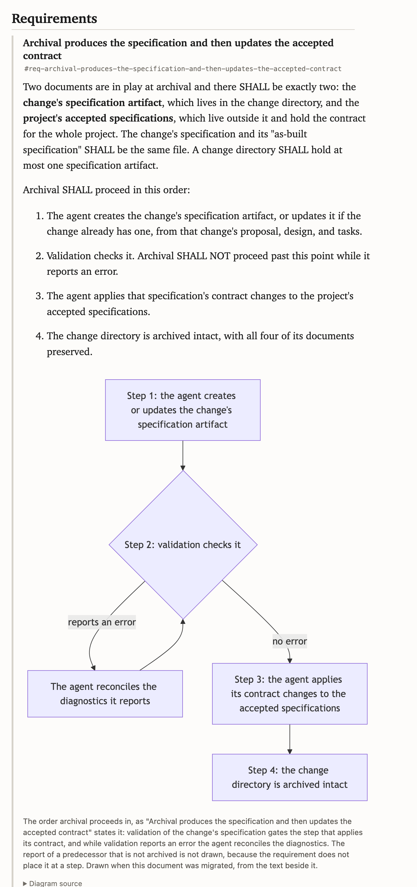
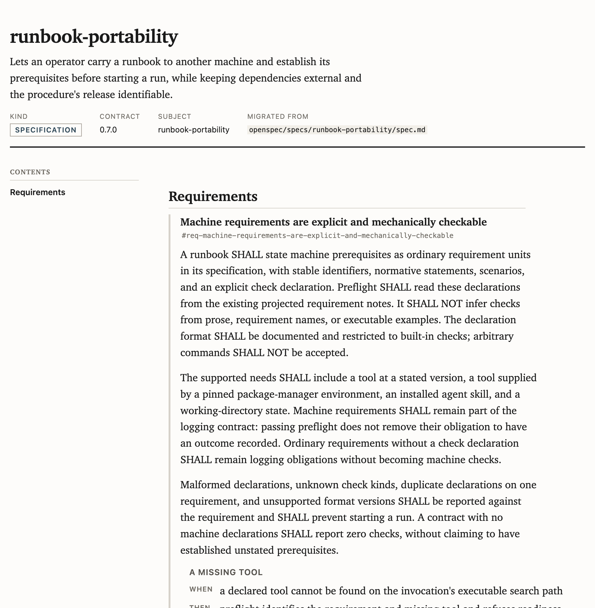
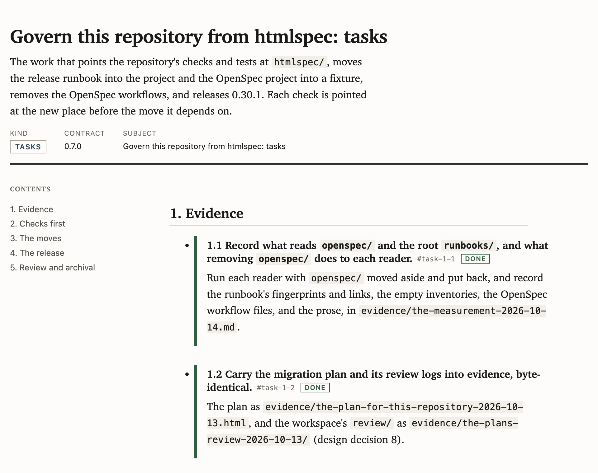
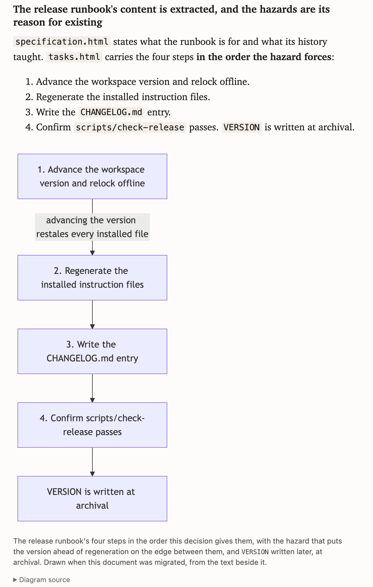

# HTMLSpec

> Spec-driven development for AI coding agents, with specifications you read in a browser.

<p align="center">
  
</p>

Your agent writes the specification. You read it the way you read any good document: in a browser, with real typography, diagrams that render, and a stable link to every requirement. When something is wrong, you say so, and the agent fixes the file. You reload.

HTMLSpec is a spinoff of [OpenSpec](https://github.com/Fission-AI/OpenSpec/). It keeps OpenSpec's discipline — agree on the change, then build it — and makes HTML the canonical format for specifications, proposals, designs, tasks, and runbooks. The page above is not rendered from Markdown. An agent edited that file, and a browser opened it.

**The HTML is the source of truth.**

## Why HTML

Markdown made sense when people typed their documents by hand. Agent-driven development runs a different loop:

1. You tell an agent what you want to build.
2. The agent writes or updates the specification.
3. You review the result.
4. You tell the agent what to change.
5. You reload the browser.

Once the agent owns the editing, the question changes. It is no longer "What is easiest to type?" It is "What is easiest to understand, inspect, discuss, and approve?" HTML is the better answer.

A serious specification needs more than headings and bullet points. It needs architecture diagrams, state transitions, timelines, charts, exact requirements, and warnings. Markdown approximates them. HTML states them directly, and every HTMLSpec project carries a pinned, offline toolkit for it:

- [Mermaid](https://mermaid.js.org/) for architecture, sequence, state, and workflow diagrams
- [Vega-Lite](https://vega.github.io/vega-lite/) for charts and quantitative evidence
- native MathML for equations
- semantic HTML for requirements, scenarios, decisions, risks, tasks, and evidence
- print styles for a clean PDF or a paper review

The house style is flat and editorial: serif text, high information density, muted color, no dashboard clutter, no tracking, and no network connection. The result is still a directory of plain files in Git. It looks like a document when a person opens it.

Why not write Markdown and render it? Because two representations raise questions one never does. Which file is canonical? Did the renderer keep the meaning? Can the agent use a diagram the pipeline does not support? HTMLSpec has one representation. The file the agent edits is the file you review.

## What a project keeps

An HTMLSpec project lives in `htmlspec/` and keeps three kinds of document. Each is a page a person reads. Each is also structured so that an agent, a validator, and a Git diff can address every part of it.

### Specifications: the contract

Accepted specifications state what the project promises. A specification is built from requirement units, and every requirement carries the scenarios that make it checkable.

<p align="center">
  
</p>

Every requirement and every scenario has a stable identifier, so the agent, the reviewer, and the diff all point at the same thing:

```html
<section class="requirement" id="req-theme-selection" data-change="added">
  <h2>Theme selection</h2>
  <p>The application must let the user select a light or dark theme.</p>

  <article class="scenario" id="scenario-theme-persists">
    <h3>The selected theme persists</h3>
    <dl>
      <dt>When</dt>
      <dd>The user selects the dark theme.</dd>
      <dt>Then</dt>
      <dd>The application uses the dark theme after the next launch.</dd>
    </dl>
  </article>
</section>
```

The browser gets a readable requirement. The agent gets explicit structure. Git gets stable, reviewable text.

### Changes: agree first, then build

A change is how a specification moves. It is a directory of four documents, and each one is a stage of a single argument:

| Document | What it carries |
| --- | --- |
| `proposal.html` | Why: the value, the need, and the scope |
| `design.html` | How: the decisions, the alternatives rejected, and the risks |
| `tasks.html` | The work, each task with its state |
| `specification.html` | The contract as built, written at archival |

<p align="center">
  
</p>

You drive the workflow from your agent. In Claude Code it looks like this:

```text
You:   /htmlspec:explore dark mode
Agent: I compared three approaches and drew the data flow.
       Option two fits best.

You:   /htmlspec:ff add-dark-mode
Agent: Created htmlspec/changes/add-dark-mode/ with a proposal, a design,
       and tasks. Each one validates. Open it in a browser.

You:   Show the failure path in the design.
Agent: Added a sequence diagram. Reload the page.

You:   /htmlspec:apply
Agent: Implemented the tasks and marked each one done.

You:   /htmlspec:verify
Agent: Checked the code against the tasks and the design.
       Every task is done, and nothing contradicts a decision.

You:   /htmlspec:archive
Agent: Wrote the specification, raised spec.nix to 0.2.0, merged the
       contract into the accepted specifications, and archived the change.
```

Archival is where a change becomes the contract. `htmlspec archive` refuses unless the project's version advances, and it refuses a specification that fails validation. Then it moves the whole change, all four documents, into `htmlspec/changes/archive/<date>-<name>/`. Nothing is thrown away: years later, a reader still finds the argument, the reasoning, and the work behind every requirement.

`htmlspec init` installs the same workflows for Codex, Cursor, and Pi, or into a plain `AGENTS.md`.

### Runbooks: procedures you run again

Some work is never finished: a release, a month-end close, an onboarding. A change archives once. A procedure runs again and again, so HTMLSpec keeps it as a runbook in `htmlspec/runbooks/<name>/`.

A runbook is two ordinary documents. Its specification states what the procedure is for and the hazards its history taught, as requirements. Its tasks document holds the steps, in the order those hazards force.

<p align="center">
  
</p>

`htmlspec new runbook <name>` starts one. It writes both documents, a `VERSION` at 0.1.0, and a changelog, so the runbook validates, passes preflight, and can run straight away. The tasks document holds the steps and a figure of their order, and a runbook can carry any figure, chart, or formula a specification can. `htmlspec list --runbooks` lists the runbooks a project holds, each with its version and title, and `htmlspec run` named with no runbook lists them too. A new runbook's name is a plain directory name: `new runbook` refuses a path, a leading dot, `assets`, and the names a project's walk passes over, such as `target`.

Runbooks carry their own discipline:

- **Versioned.** A runbook has its own `VERSION` and `CHANGELOG.md`. Archival refuses changed steps that kept the old version.
- **Checked before they start.** `htmlspec preflight <runbook>` reports a missing tool or the wrong working directory before step one, not at the step that needed it.
- **Recorded.** `htmlspec run <runbook> --as <record>` starts a run. The record copies the procedure it ran, so you always know which version ran and what it produced.
- **Portable.** Copy a runbook to another machine and run it there. See [Carrying a runbook to another machine](#carrying-a-runbook-to-another-machine).

This repository releases itself with one: [`htmlspec/runbooks/release/`](htmlspec/runbooks/release/).

## Getting started

Install the `htmlspec` command with the package manager you already use:

```sh
nix run github:Firefly-Projects/htmlspec        # Nix, from the flake
brew install Firefly-Projects/tap/htmlspec      # Homebrew, on macOS and Linux
cargo install --locked htmlspec-cli             # crates.io; the binary is named htmlspec
```

Or download a binary for macOS or Linux from the [releases page](https://github.com/Firefly-Projects/htmlspec/releases), where `SHA256SUMS` lists each file's digest. `htmlspec --version`, or `-v`, prints the release you installed and the commit it was built from. `--locked` makes `cargo install` build with the dependency versions the release was tested with, rather than the newest ones each requirement allows.

A binary ships with three license files. `LICENSE` is htmlspec's own MIT license. `THIRD-PARTY-LICENSES` holds the notices of the JavaScript libraries the binary embeds, Mermaid and Vega among them. `CRATE-LICENSES` holds those of the Rust crates it is built from. Each release tarball holds them beside the binary, Homebrew installs them in the formula's prefix, and the Nix package installs them under `share/doc/htmlspec/`.

To build from source instead, use [Nix](https://nixos.org/) or a Rust toolchain matching `rust-toolchain.toml`:

```sh
nix build                 # the htmlspec binary, at result/bin/htmlspec
cargo build --release     # or without Nix
```

Then set up a project and start a change:

```sh
htmlspec init --tools claude          # htmlspec/, spec.nix, and your agent's workflows
htmlspec new change add-dark-mode     # a change: proposal, design, and tasks
htmlspec validate                     # check every document in the project
```

## Reading the documents

Open any document in Firefox or Chrome. Every page reads its stylesheet and scripts from the project's one asset store, so it renders offline with no build step.

Safari is stricter. When it opens a file from disk, it refuses a stylesheet in a parent folder, and the store always sits above the document. So every document the program writes also carries a small fallback stylesheet in its head. In Safari the page still reads as a centred serif column with monospace code. Everywhere else the real stylesheet wins, and the fallback changes nothing.

The fallback buys a readable page, not the full design. The store's scripts draw the diagrams and charts, and no stylesheet can replace them. If Safari refuses those scripts too, each figure shows its caption and its diagram source instead. To see the whole design in Safari, serve the project. From the directory that holds `htmlspec/`:

```sh
python3 -m http.server
# then open http://localhost:8000/htmlspec/specs/
```

Documents written before 0.31.0 have no fallback. `htmlspec format --fallback` adds it to them.

## Reference

### Commands

`htmlspec init` takes no path. Its subject is the repository you are standing in.

```sh
htmlspec init                       # set up this project, interactively
htmlspec init --tools claude,codex  # or name the tools and skip the prompt
htmlspec init --tools none          # or install no agent instructions at all
```

It creates `htmlspec/` with `specs/`, `changes/`, `changes/archive/`, and `runbooks/`. It establishes **one** shared asset store at `htmlspec/assets/`, writes a `spec.nix` declaration, and installs the workflow instructions for the tools you choose. It detects which tools your project uses and preselects them.

`init` is safe to run again. It refreshes the instructions and leaves your specifications, changes, archive, and runbooks alone. That is how a project picks up a newer version's instructions.

```sh
htmlspec new change add-dark-mode                # a change: proposal, design, and tasks
htmlspec new runbook deploy                      # a runbook: specification, tasks, VERSION, changelog
htmlspec new document specification s.html       # or one document of a given kind
htmlspec validate                                # every document in the project
htmlspec validate proposal.html --strict         # one document, warnings fatal
htmlspec format                                  # rewrite documents into canonical form
htmlspec format --check                          # report without writing; nonzero if any would change
htmlspec format --fallback                       # also give each document the fallback stylesheet
htmlspec format --upgrade-assets                 # also move documents onto the store's current assets
htmlspec assets                                  # check the project stores each asset once
htmlspec list --runbooks                         # the runbooks the project holds, with versions and titles
htmlspec preflight release                       # can this runbook start on this machine?
htmlspec show add-dark-mode --diff               # each requirement it modifies, beside the accepted one
htmlspec archive add-dark-mode                   # check a change before archiving it
htmlspec validate --json                         # structured diagnostics on stdout
htmlspec -v                                      # the version, as --version and -V print it
```

Every project-wide command finds its project by walking up from where you run it, so each one works from any directory inside the project. A new change or runbook goes where the project keeps it, and the command reports the resolved path.

`format --upgrade-assets` rewrites each document's references to the stylesheet and scripts this release writes into new documents. It never downloads anything: the current assets are compiled into the program, and any the store lacks are written into it from that copy. It adds nothing a document does not already load, and it leaves archived changes and run records as written, judging each document by the project it belongs to wherever you run it from, a link's target included. `--fallback` keeps history the same way. Where a stored file no longer matches its address, it leaves the reference as written and says how to restore the file. Without the flag, formatting leaves every reference to stored bytes as written, so a document keeps rendering with the bytes it was reviewed against until someone asks to move it.

Every operation also has a request-verb spelling, borrowed from htmx's request keywords. `get` never writes. `post` creates something that was not there. `put` creates or replaces a whole thing, and running it again leaves the same result. `patch` changes something that exists. `delete` removes something. Both spellings run the same operation, with the same arguments, options, output, and exit status.

The verb names the most an operation writes in any invocation, so `put format --check` writes nothing, as `format --check` does. The program's messages and the instructions it installs use the OpenSpec spelling, because adopters arrive from OpenSpec. The verbs send nothing anywhere.

| Operation | OpenSpec spelling | Request-verb spelling |
| --- | --- | --- |
| Validate documents | `validate` | `get validity` |
| List what the project holds | `list` | `get list` |
| Report a change's completion | `status` | `get status` |
| Report whether a change reached the accepted specifications | `sync` | `get sync` |
| Show modified requirements beside the accepted ones | `show` | `get show` |
| Check the asset topology | `assets` | `get assets` |
| Check a runbook's machine prerequisites | `preflight` | `get preflight` |
| Print a stage's workflow instructions | `instructions` | `get instructions` |
| List registered stores | `store list` | `get registrations` |
| Survey an OpenSpec project | `migrate survey` | `get survey` |
| Create a change | `new change` | `post change` |
| Create a document | `new document` | `post document` |
| Create a runbook | `new runbook` | `post runbook` |
| Register a store | `store add` | `post registration` |
| Start a run of a runbook | `run` | `post run` |
| Promote a staged migration | `migrate promote` | `post promotion` |
| Set up or refresh the project | `init` | `put project` |
| Format documents | `format` | `put format` |
| Archive a change | `archive` | `patch archive` |
| Remove a store's registration | `store remove` | `delete registration` |

`htmlspec --help` lists the verbs after the operations, and `htmlspec get --help` names the operation each of its objects runs.

Documents reference the project's one asset store relatively. Copy or rename the project anywhere and every page still opens with no network. Moving a *single change* out of its project breaks its references, deliberately: the alternative is a copy of the 6 MB runtime per change. `htmlspec validate` reports the broken reference instead of accepting a page that renders against nothing.

Exit codes are a contract:

| Code | Meaning |
| --- | --- |
| `0` | Success. |
| `1` | A document violates the contract, or a completed preflight found requirements unmet. Both are an unsatisfied contract, not a broken tool. |
| `2` | The operation could not run at all, for example an unreadable file or an invalid invocation. |
| `3` | You declined a prompt or interrupted the run. Nothing went wrong, and nothing was done. |

With `--json`, standard output carries nothing but the payload, every progress message goes to standard error, and no prompt appears. Each operation's payload has a JSON Schema in `crates/htmlspec-cli/schema/payload/`. A later 1.x release can add a field to a payload, so a script ignores a field it does not know.

### Carrying a runbook to another machine

A runbook states what it needs of a machine. `htmlspec preflight <runbook>` reports what is missing before a run starts, not at the step that needed it. Starting a run performs the same checks, and nothing skips them. A preflight you ran earlier is not permission: every start observes the machine afresh.

A machine requirement is an ordinary requirement unit in the runbook's `specification.html`, with its check declared in a note:

```html
<section class="requirement" id="req-start-outside-a-project" data-change="unchanged">
  <h3>The run starts outside a project <span class="hs-id">req-start-outside-a-project</span></h3>
  <p>A run MUST start in a directory that is not inside an existing project.</p>
  <p data-field="note">preflight/v1 {"kind":"state","check":"outside-project"}</p>
  <!-- a scenario, as any requirement carries -->
</section>
```

The note's projected text begins `preflight/v1 ` followed by one JSON object. There are four forms and nothing else. A runbook cannot supply a command, an argument, or a regular expression. A carried document able to run arbitrary code during an inspection is not an inspection.

| `kind` | Fields besides `kind` | What it checks |
| --- | --- | --- |
| `tool` | `program`, `version` | A bare executable on the invocation's `PATH`, reporting exactly that `major.minor.patch` |
| `toolchain` | `manifest`, `shell`, `tools` | A local locked `flake.nix`, its named development shell, and the executables it supplies |
| `skill` | `scope`, `path` | A readable, nonempty `SKILL.md` in the `home` or `workdir` scope, at that relative path |
| `state` | `check` | `outside-project`, or `clean-git-worktree` |

Paths are relative, and they cannot be absolute or climb out with `..`. Executable names are bare: no separator, no leading hyphen. A requirement holds one declaration, and every declared check must pass. A note that begins `preflight/` and names a version this program does not read is an error, not prose. Skipping it would report a runbook ready when it asked for checks nothing performed.

A runbook can also say where to get what a check needs. `preflight/v2` reads every form `preflight/v1` reads, plus one optional field, `remedy`:

```html
<section class="requirement" id="req-the-login-skill-is-installed" data-change="unchanged">
  <h3>The login skill is installed <span class="hs-id">req-the-login-skill-is-installed</span></h3>
  <p>A run MUST have the login skill installed.</p>
  <p data-field="note">preflight/v2 {"kind":"skill","scope":"home","path":".claude/skills/login/SKILL.md","remedy":"copy skills/login from the team's skills repository into ~/.claude/skills"}</p>
  <!-- a scenario, as any requirement carries -->
</section>
```

A remedy is one line of 1 to 200 characters, and every character in it is shown as what it is. It holds no control character, no whitespace but the plain space (so no tab, no non-breaking space, and no line or paragraph separator), and no invisible character: none of Unicode's format characters or default-ignorable characters, the bidirectional ones and the variation selectors included, and not the braille pattern blank, which draws as a space. The zero-width joiner and non-joiner are the exceptions, because scripts and emoji need them, and so is one emoji presentation selector directly after the character it is for. Spaces around it are trimmed, and a remedy with no visible character is refused as empty. When a check does not pass, the report shows the program's own remedy and then `the runbook says:` with the runbook's text, so you can tell the two apart. With `--json`, every check whose declaration carries a remedy has `runbookRemedy`, passed or not. A remedy is text. Preflight never runs it, never opens an address in it, and never counts it as satisfying anything: the skill still has to be installed. htmlspec 1.0 refuses `preflight/v2` as a format it does not read, so a runbook that declares a remedy needs 1.1 or later. A runbook with no remedy keeps writing `preflight/v1`, which every version reads.

What the checks are, and what they are not:

- **A tool check runs the resolved executable with `--version` and reads one standalone three-component number out of its output.** No shell, closed stdin, ten seconds, 64 KiB of output. Output holding two candidate versions is ambiguous, and preflight reports it instead of guessing. A tool with another version interface needs an adapter. The runbook cannot supply the argument.
- **A toolchain check asks the package manager and provisions nothing.** For Nix it evaluates the selected development shell's inputs offline, with lock updates and import-from-derivation disabled. Then it compares where each named tool resolves against the store paths those inputs already occupy on this machine. It never runs `nix develop`, `build`, `shell`, or a fetch. An environment whose inputs are not realized is *unavailable*, not failed, and nothing downloads to make it available. No version is copied out of the manifest into a second dependency catalog, which is why the form names the manifest.
- **A skill check establishes that installed content is readable, not that it is good.** A symlink escaping its scope is refused. A copy bundled beside the runbook does not satisfy a `home`-scope declaration, because the question is whether the skill is installed.
- **A state check is about the invocation's working directory, not the store's.** `--store` selects where documents are read from. `clean-git-worktree` uses a read-only status with optional locks disabled, and counts modified, staged, conflicted, and untracked files alike. A directory that is not a repository is unavailable, not clean.

Preflight reports and does not repair. Choosing how to install something on an unknown machine is judgment. So the report names a remedy for each refusal and leaves the choice to you.

A runbook's run records live in the project it came from. So a carried runbook needs a version of its own: `VERSION` beside its documents, and a `CHANGELOG.md` heading for it. Archival compares each runbook's canonical documents against the last release it published, and refuses one version for two different contents. A version identifies one released procedure. A run's record is not part of that comparison, because a runbook exists to be run, and neither is changelog prose.

A copy needs very little:

```text
portable/
  htmlspec/
    assets/                 one shared asset store, copied
    runbooks/release/
      specification.html
      tasks.html
      VERSION
      CHANGELOG.md
      runs/                 created by the first run started here
```

Register it with `htmlspec store add portable <path>`. Then check and run it from the directory the work is in: `htmlspec --store portable preflight release`. The source project's archive, declaration, accepted specifications, and old run records stay behind, and a new local run does not need them. Transport is not a command. Copying is yours, and `git`, an archive, or `cp` are all equally correct.

Older runbooks have no `VERSION`. Starting one is refused with the migration, instead of recorded anonymously. Reviewing the runs an older runbook already has still works: `htmlspec run <runbook> --check` reports conformance and never inspects the machine.

### The project declaration

`init` writes `spec.nix` at the project root:

```nix
{
  name = "my-project";
  version = "0.0.0";
  htmlspec = null;   # replace with a pinned flake reference
}
```

`htmlspec archive` reads `version` and refuses unless it is **ordered after** the last archived version, so the accepted contract carries a history. Advancing it is your work, or your agent's. The program only compares. Versions start at `0.0.0` and are ordered componentwise, so `0.10.0` follows `0.9.0`.

### Layout of a project

```text
spec.nix                               Project name, version, and pinned toolchain
htmlspec/
├── assets/                            Pinned CSS and visualization runtime, one copy
├── specs/
│   └── theme-selection.html           An accepted specification
├── changes/
│   ├── add-dark-mode/
│   │   ├── proposal.html              The value, need, and scope
│   │   ├── design.html                Architecture and technical reasoning
│   │   ├── tasks.html                 The work items and their states
│   │   └── specification.html         The settled contract, produced at archival
│   └── archive/
│       └── 2026-08-04-add-dark-mode/  Every document intact, and a VERSION file
└── runbooks/
    └── release/
        ├── specification.html         What the procedure is for, and its hazards
        ├── tasks.html                 The steps, in order
        ├── VERSION
        ├── CHANGELOG.md
        └── runs/                      One record per run
```

The asset store is the project's, not each change's. One copy of the runtime serves the whole project, however many changes it holds.

### Validation

`htmlspec validate` checks structure and safety before a change is accepted:

- every requirement and scenario has a stable, unique identifier
- every internal link and fragment resolves
- task and verification references point to real requirements
- the HTML parses without error recovery, so its reading is deterministic
- example code is inert, and only the pinned runtime executes
- every embedded chart and diagram is checked against its own format
- nothing reaches the network: remote scripts, fonts, and tracking are rejected
- the core content reads with scripting disabled

The goal is not merely attractive output. It is an artifact that agents modify reliably and people actually read.

### HTML is the artifact, not the application

HTMLSpec does not turn a proposal into a miniature web application. The baseline is semantic HTML and CSS. JavaScript enhances diagrams, charts, and navigation, and a specification stays readable when JavaScript fails or is turned off.

The runtime is local, offline, and pinned to known versions. The project shares one copy instead of copying it into each document. Only approved libraries run, and an agent parsing a document needs none of them.

### Design principles

- **Browser-first review.** The browser is the primary human interface. Source view and Git diffs still matter, but they are not the only way to understand a change.
- **Agent-authored, human-directed.** People own intent, judgment, and approval. Agents own the repetitive work of keeping the artifacts consistent.
- **Semantic before decorative.** Requirements, scenarios, decisions, evidence, risks, and tasks use stable HTML structures. Styling helps comprehension and never hides meaning.
- **Visuals when they earn their space.** Diagrams explain topology and sequence. Charts explain evidence. Tables hold exact comparisons. Ordinary prose stays ordinary prose.
- **Fluid, not ceremonial.** Exploration, proposal, design, implementation, and verification can loop. The format supports the work instead of forcing rigid phase gates.
- **Local, portable, and durable.** Specifications work offline, live beside the code, and travel through Git. No hosted service is required.
- **Deterministic and reviewable.** Stable identifiers, predictable ordering, canonical formatting, and validation keep rich output from producing noisy diffs.

### Relationship to OpenSpec

[OpenSpec](https://github.com/Fission-AI/OpenSpec/) provides the starting model: lightweight spec-driven development, a fluid change lifecycle, plain files in the repository, and support for many coding agents.

HTMLSpec explores one deliberate disagreement. OpenSpec treats plain Markdown as a feature. HTMLSpec treats the browser as the review surface and the agent as the document editor. `htmlspec migrate survey` and the `/htmlspec:migrate` workflow bring an existing OpenSpec project across.

The project also builds on the argument in [The unreasonable effectiveness of HTML](https://claude.com/blog/using-claude-code-the-unreasonable-effectiveness-of-html). Once agents create and revise our technical artifacts, richer and more readable output keeps people engaged in the work.

HTMLSpec is an independent experiment and is not affiliated with Fission AI or Anthropic.

### Building

With [Nix](https://nixos.org/):

```sh
nix build              # the htmlspec binary, at result/bin/htmlspec
nix run . -- --help    # run it without installing
nix develop            # a shell with the pinned toolchain
nix flake check        # the full check suite
```

Without Nix, a Rust toolchain matching `rust-toolchain.toml` is enough:

```sh
cargo build --release
cargo run --bin htmlspec -- --help
```

The packaged binary needs no source checkout and no Nix at runtime.

### Checks

One command runs everything: formatting, lints, every test, the conformance fixtures, the asset lockfile hashes, the enhancement-script byte budget, and this project's own documents, checked through the built binary.

```sh
scripts/check
```

`nix flake check` and continuous integration both run that same script instead of keeping their own step lists, so all three check the same thing. To change what is checked, change the script.

### Landing a change

Work reaches `main` through a pull request, never by a push to it. Install the hook that enforces that locally, once per clone:

```sh
scripts/install-hooks
```

Git does not install hooks from a clone on its own, and it is right not to. A repository that ran code out of its own working tree on clone would be a remote execution vector. The installer points `core.hooksPath` at `.githooks/`, which holds one hook: `pre-push`, refusing a push to `main`. In the private working repository the project is published from, it also refuses every push to the public repository, because a push from there would carry that repository's history. The public repository receives only exports.

Then the loop is ordinary:

```sh
git switch -c a-branch-naming-the-change
# work, commit
scripts/check
scripts/check-pull-request --title "The title you will give the pull request"
git push -u origin HEAD
gh pr create
```

Two workflows check what arrives, and a branch ruleset guards `main`:

| Workflow | Asks | Runs |
| --- | --- | --- |
| `check.yml` | is this revision healthy? | `scripts/check`, on every pull request and every push to `main` |
| `pr-guard.yml` | is this a well-formed proposal? | `scripts/check-pull-request`, on the pull request's title and diff |

`pr-guard` enforces two things. The title becomes the squash commit's subject, so it must read the way this project's history reads: imperative prose under 72 characters, no Conventional Commits prefix, no trailing period. And the diff must touch `CHANGELOG.md`, unless the pull request carries the `skip-changelog` label to state that there is nothing worth recording. Both rules live in `scripts/check-pull-request`, which you can run before you push. The workflow only supplies it with the event's facts.

The ruleset on `main` requires a pull request and has no bypass, so GitHub refuses a direct push, a force-push, or a deletion of `main` outright. The hook stops the same mistake earlier, on your machine, before anything leaves it.

For a repository whose `main` has no ruleset, the hook's check can be skipped on purpose:

```sh
HTMLSPEC_ALLOW_MAIN_PUSH=1 git push origin main
```

The variable exists so the escape is visible. `--no-verify` skips every hook silently and leaves no record of intent. This names the decision, and the ruleset still decides whether the push is accepted.

### Source layout

| Path | Contents |
| --- | --- |
| `crates/htmlspec-schema` | the JSON Schema contract, the projection specification, and the types generated from them |
| `crates/htmlspec-parse` | HTML to document model, including fatal parse-error handling |
| `crates/htmlspec-format` | the canonical serializer |
| `crates/htmlspec-validate` | the rule engine and diagnostics |
| `crates/htmlspec-assets` | the asset store in its `assets/`: the templates, the lockfile, the stylesheets, the enhancement script, and the vendored libraries a document renders through |
| `crates/htmlspec-cli` | the `htmlspec` binary |
| `conformance` | the fixture harness, driving the crates' public APIs only |
| `fixtures` | conformance, projection, parse-error, and hand-authored example documents |
| `packaging` | the Homebrew formula's template, which `scripts/render-formula` fills for each release |
| `htmlspec` | this repository's own project: its specifications, changes, archive, and release runbook |

The public contract is three pieces, not one: `crates/htmlspec-schema/schema/document.schema.json` for the shape of the model, `crates/htmlspec-schema/doc/projection.md` for the HTML-to-model mapping, and the fixtures that pin it. An implementation written from those reproduces the model with no access to this source.

## Project status

HTMLSpec 1.0.0 is the first release that makes promises, and 1.1.0 keeps them. This repository runs on it: its own specifications, changes, and runbooks are the HTML documents in [`htmlspec/`](htmlspec/). It migrated itself out of OpenSpec at 0.29.0.

Release 1.0.0 implements:

- **the document format:** the contract, the parser, the validator, the canonical formatter, the visual system, and the offline runtime
- **the command-line toolchain**, with an OpenSpec spelling and a request-verb spelling for every operation
- **the change lifecycle**, and the agent workflows that drive it
- **runbooks:** versions, preflight, runs and their records, and portability
- **migration from an OpenSpec project**

Release 1.1.0 adds:

- **the notices of the Rust crates** the binary is built from, in every channel that ships it
- **`htmlspec new runbook`** and **`htmlspec format --upgrade-assets`**, and a runbook listing from `run` and `list --runbooks`
- **install hints:** `preflight/v2` lets a runbook say where to get what a check needs
- **`htmlspec -v`**, and an export that pushes as the account `gh` is signed in as

**What 1.0 promises.** Two requirements state it:

- **The document contract follows semantic versioning.** document-schema's "The contract's version is a semantic version" states it. Within a major version, a document one version accepts gains no error under any later version. A minor release adds vocabulary and can add warnings. Contract `1.0.0` is the `0.7.0` vocabulary, unchanged, so every document that declares `0.1.0` to `0.7.0` still validates. The suite checks that each conformance fixture gains no error under `1.0.0` that it lacked under the version it declares. It cannot check that a rule added later leaves a valid document valid, so review holds that line: a change to what a fixture expects is a change to the contract.
- **The command surface is stable within 1.x.** toolchain-packaging's "The command surface is stable within a major version" states it. Every operation keeps its name in both spellings. Every flag keeps its name and meaning, every exit code its value, and every `--json` field its name and type. A minor release can add any of them, and only 2.0 removes or renames one. The suite fails when the program loses any of them. The wording of human-readable output can still change, so a script that needs an answer reads `--json`.

The suite holds the surface to one file per released minor, [`1.0.json`](crates/htmlspec-cli/tests/surface/1.0.json) and [`1.1.json`](crates/htmlspec-cli/tests/surface/1.1.json), each read from the program's own parser: the program keeps everything an earlier file of its major records, and the current minor's file records exactly what it does. Each payload has a published JSON Schema under [`crates/htmlspec-cli/schema/payload/`](crates/htmlspec-cli/schema/payload/). A published schema admits a field it does not declare, so output from a later 1.x release still validates against it. The suite reads the same schemas strictly, so the program writes only what its schema declares.

One piece of the original proposal is not built yet: **portable single-file exports**. An export would inline the runtime into one document that travels alone, for email, archival, or an external review.

HTMLSpec succeeds when a developer asks an agent for a substantial change, opens one page, and understands the plan. No wall of Markdown stands in the way. It succeeds when better presentation makes people read specifications more closely and catch bad decisions earlier. Then people stay in control while agents do more of the implementation.

If the premise is right, the interface for spec-driven development is not another text format.

It is a browser tab.
