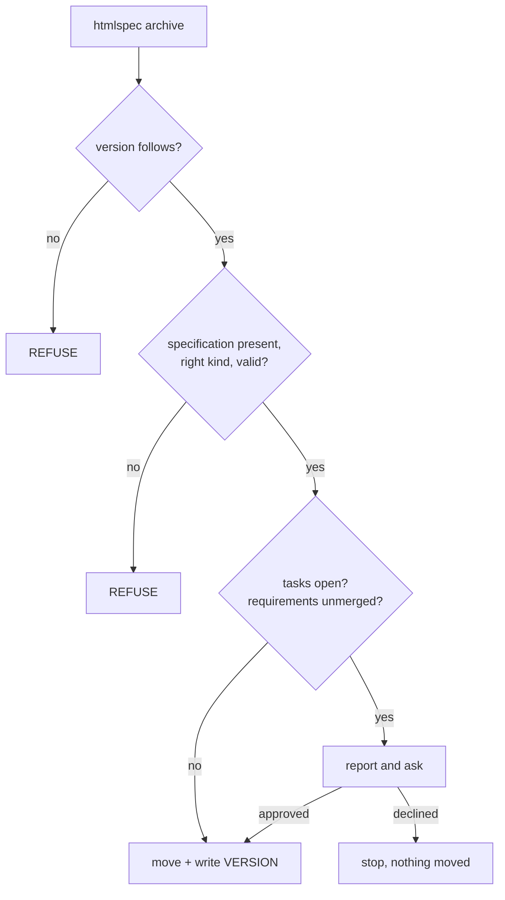

## Context

Archival in HTMLSpec is six steps, of which the program performs one. The agent produces the
change's specification, advances the version, runs `htmlspec archive`, merges the contract into
the accepted specifications, moves the directory, and reports. Step three is the program. The
other five are instructions in `.pi/skills/htmlspec-archive-change/SKILL.md`, and instructions do
not fail.

The division was deliberate and it is mostly right. `artifact-kinds` states the reason: a proposal
and a design carry no imposed structure, so no rule locates an obligation inside them, and an
extractor that guessed would emit documents that satisfy every check while misrepresenting their
source. That argument is sound and this change does not touch it.

What the division got wrong is the boundary. It placed *moving a directory* on the judgment side.
Nothing about `mv` is judgment. The sentence that put it there is in `project-bootstrap`:

> A command whose stated job is checking SHALL NOT write to the project it checks.

Read in context that sentence is defending something real — the paragraph around it is about the
version, and it says advancing the version is the contributor's act and the program's part is the
comparison alone. That is correct and it stays. But the sentence generalises from a version to
every write, and from a specific act of judgment to a command's "stated job", and those two moves
are what left archival unfinished. A command's stated job is a naming decision. It should not
determine what the command is permitted to do.

## Goals

- Archival completes or leaves the project untouched. There is no state in which the report says
  archived and the directory says otherwise.
- The version gate fires. It has never fired.
- The contract gates absolutely. The work informs.
- The merge stays agent-driven, and the program can tell whether it happened.
- The four commands the workflow instructions already invoke exist.

## Non-Goals

- Programmatic merging or extraction. `artifact-kinds` is untouched.
- Advancing the version. `archive` compares and never edits the declaration.
- Renaming the 11 existing archived changes.

## Decisions

### The line moves from "which command" to "which act"

The old line asked what a command is called. The new line asks what an act requires.

| Act | Requires | Who |
| --- | --- | --- |
| Deciding what a change established | Reading prose whose structure was the author's | Agent |
| Deciding which accepted requirement a scenario belongs under | Same | Agent |
| Deciding what a version increment signifies | Judgment about significance | Contributor |
| Comparing two version numbers | An ordering | Program |
| Checking a document against the schema | Stated rules | Program |
| Observing that an identifier is absent | A set membership test | Program |
| Moving a directory and writing a file | Nothing | Program |

Every row is unchanged from what the project already believes. The change is that the last two
rows are now allowed to be in the same command as the rows above them.

This is a narrowing of the old requirement rather than a reversal. What `project-bootstrap` was
protecting survives verbatim: archival SHALL NOT modify the declaration, and advancing the version
SHALL be the contributor's or the agent's act. That obligation is restated on the act, where it
belongs, instead of on the command's name.

### The version gate reads what the project records

`last_archived_version` scans archive directory names for a dot-separated triple.
`Version::parse` requires exactly three numeric components, and no archive directory name has one
— they are `<date>-<name>`. The function therefore returns the `0.0.0` fallback for every project
in existence, including this one, and any declared version passes.

Meanwhile `toolchain-packaging` already requires each archived change to record its version *in a
form the project's own suite can read without version control history*, and all 11 archived
changes carry a `VERSION` file. The convention exists. The gate reads a different one.

The fix is to read the `VERSION` file, not to start writing versions into directory names. Three
reasons, in order of weight. It is the form an accepted requirement already fixes. It works
against the existing archive immediately, with nothing renamed and no migration. And a directory
name is a display string that people shorten and rename, while a file with one line in it is a
record.

`archive` writes that file as part of the move, which is what closes the loop: the program that
reads the convention is the program that writes it, so the two cannot drift.

### Assessment is mechanical, the merge is judgment, and archival needs only the first

The merge must stay agent-driven. Archival still needs to know whether it happened, or the
completion guarantee is empty.

The resolution is that the two questions have different difficulty. *How should this requirement
be folded into that capability?* is judgment — it needs a decision about which existing requirement
a scenario belongs under, and about what to leave alone. *Does requirement `req-archival-completes`
appear in any accepted specification?* is a set membership test over identifiers.

So `archive` collects the requirement identifiers in the change's `specification.html`, collects
those in the accepted specifications, and reports the difference. It never proposes a merge, never
edits an accepted specification, and never decides that an absent identifier is an error — a
withdrawn requirement is legitimately absent, and only an agent knows which case it is. It warns
and asks.

This is the same shape OpenSpec uses, and worth being precise about because the CLI help
misdescribes it. `openspec archive` advertises *update main specs*, but the workflow vendored in
this repository routes the merge to `openspec-sync-specs`, which it labels an agent-driven
intelligent merge. Both tools assess mechanically and merge by judgment. Only one of them
currently assesses.

### What refuses and what asks

The split is not arbitrary. Everything above the prompt concerns the contract, which is what
archival makes permanent and what the rest of the project is checked against. Everything at the
prompt concerns the work, which is the contributor's business and which they can legitimately
decide is finished when a task list disagrees. A dropped task is a normal outcome and the archive
workflow already says so.

The version gate keeps its position first, for the reason its own comment gives: a contributor
sent to fix documents when the blocker is one line in the declaration has been sent to the wrong
file.

### A prompt cannot be the only way through

`archive` runs inside agent loops. An operation that always stops for a human cannot be driven by
one, and an operation that never stops will archive over a warning nobody read.

So the prompt appears when the stream is interactive, and `--yes` accepts the warnings without
one. Under `--json` there is no prompt at all: the payload carries the warnings and a field
saying whether the move happened, and without `--yes` a warned run exits nonzero having moved
nothing. An agent that wants to proceed says so explicitly, which is the same contract `--yes`
carries everywhere else.

### The move is atomic, and the collision is refused

Target name is `<YYYY-MM-DD>-<change-name>`, with the date prefix skipped if the name already
carries one — the same rule OpenSpec uses, and it exists because a change archived twice must not
become `2026-08-30-2026-08-29-<name>`.

If the target exists, refuse. Do not suffix, do not merge into it, do not overwrite. A collision
means either the change was already archived or two changes share a name on one day, and both
want a person.

The move is a rename within one filesystem, so it is atomic. If the `VERSION` write fails after
the rename, report the archive location and the failed write together — the change is archived and
one file is missing, which is recoverable and must not be reported as a failed archival.

### The four commands, and what each one is here

`list` and `status` are load-bearing for `archive`. The other two are here because the workflow
instructions have invoked them since they were vendored.

- **`list`** enumerates active changes, `--specs` enumerates accepted specifications, `--json`
  emits both for agents. This is the change-selection primitive, and its absence is why the
  HTMLSpec prompts have no selection step.
- **`status --change <name>`** reports which of a change's artifacts exist and which of its tasks
  are complete. `archive` calls the same code for its warning.
- **`instructions <artifact>`** prints the workflow instructions for an artifact kind, plus
  archival and application. `init` installs these into tool directories today. Printing them on
  demand means an agent gets the current text without knowing which tool directory it is in, and
  without a stale installed copy.
- **`store`** registers standalone HTMLSpec repositories on the machine, so specifications can
  live outside the repository being worked on. This is the largest of the four and the only one
  that adds a concept rather than a report.

### Risk: the withdrawn requirement was load-bearing in a way this misses

It is an accepted requirement with a stated reason, and this change withdraws part of it on the
argument that the reason is narrower than the sentence. The mitigation is that the narrower
obligation is written down rather than assumed: archival SHALL NOT modify the declaration, stated
on the act. If the argument is wrong, it is wrong visibly, in a requirement someone can disagree
with.

### Risk: `store` is a change of its own

Three of the four commands report on what is already there. `store` introduces machine-level state
outside any repository, with its own resolution rules and its own failure modes when a registered
store moves or disappears. It is scoped last in the task list for that reason, and it is the part
to cut if this change is too large. Cutting it does not block `archive`, which needs only `list`
and `status`.

### Risk: warning fatigue turns the prompt into a reflex

A prompt answered yes every time is a prompt that is not read. The mitigation is that the warnings
are specific and countable — this many open tasks, these requirement identifiers absent — rather
than a generic caution. A warning that names three identifiers is one a contributor can check in
under a minute.

## Risks

The three above are the ones with mitigations worth stating. The residual risk is scope: this
change alters an accepted requirement, changes a command from read-only to performing, and adds
four commands. It is large. The task list sequences it so that the contract change and `archive`
land before the commands that are not load-bearing, and so that `store` is severable.
